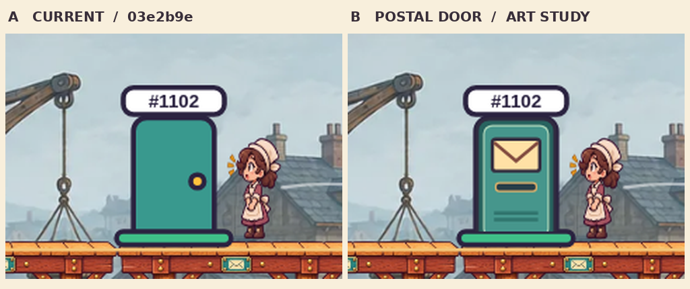

# 弹簧快递美术台账 · 11 月 27 日
源码 03e2b9e；CrazyGames 上次确认包 774a9f5。11 月 26 日 HANDOFF 和 STATUS 记录的是旧分支阶段。11 月 19 日《美术-评估与出图清单》要求横、竖、方封面，logo 可选；未查到把剩余重画锁定为数天的原始排期。

左为当前第 11 关 #1102 门，右为独立矢量叠图。先请 Nick 判断信封和投递口能否让玩家更快认出交付处。门牌、地垫、收件人和脚下屋顶保留。首批只定这一种造型。

|位置及状态|依据|新增图件|优先级|预计人日及依赖|
|---|---|---:|---|---|
|第 11 关起的剧情终点、无尽交付点，共用交付门；建议重做|index.html drawDoor；第一章已有收件箱，之后是纯色圆角门和门把；见实图|1 个共用母版，本次 1 张样稿|P1|定样与小尺寸修整 0.5，认可后分支接入 0.5，场景回归 0.5–1；门号动态绘制|
|菜单、暂停、选关、结算、商店；待设备验收|085c0a8、bb96ed6、6d62975；短屏按钮及 Safari 标签残影|0|P1|0.25–0.5；短屏 iPhone Safari|
|换装及头顶包裹；已接入待抽验|1925565、ed4403a；15 套 × 4 姿势，重点忍者双金箱试穿与实战|0|P1|0.25–0.5；需试穿存档及四个姿态|
|海港栈桥、系缆桩、旗杆及水面；验边缘|db6b87b、8991d8d、b829e9e、03e2b9e；painted-scenes 有 flag、water-harbor、water-ice|0|P1|0.25；普通港及冰港实景，浅蓝水色已定|
|剧情楼体、雨雪与冰港、终章挥手、无尽夜景；已接入待覆盖|a86c764、fdd7f06、ee20eda、b829e9e、5cd3eb2；六张背景共享，按章节加天气与建筑变化|0|P2|0.5；按主题抽样，终章单验|
|窄墩、路灯、风扇、通风口及晾衣绳；观察|ART-COVERAGE、当前 Canvas 绘制；路灯黄铜帽宽随平台，未发现必须重画依据|0|P2|随场景回归；路灯脚面保持原宽；玩法意见交日常线|
|平台封面及视频；独立验收|1888a6f、3b29285、45adf8f；art/review/crazygames 有三比例封面及横竖实录|0|P2|封面缩略图抽验 0.25；更新水色后的实录由日常线安排|

云端 Chromium 从无存档玩家入口打开第 1 关，在 390×844、1280×720 均用指针蓄力释放，观察到角色离地。对照图另用第 11 关定位、冻结镜头并局部放大。未验证自然通关、真机触控、Safari 或其他章节的门。当前明确的美术差异只有共用交付门，Nick 尚未批准接入；第二种环境皮肤也需有实景证据再计。按一次定样、可及时取得设备估计：交付门 1.5–2 人日；加其余现有美术抽验约 3–4 人日，等待反馈与平台录屏另计。
